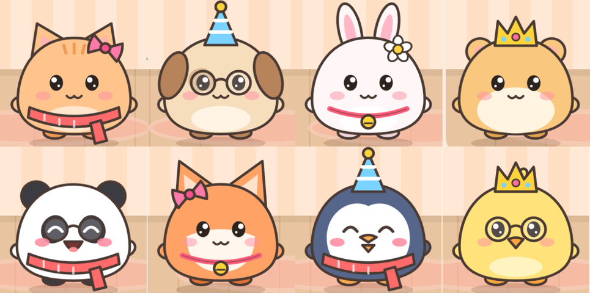
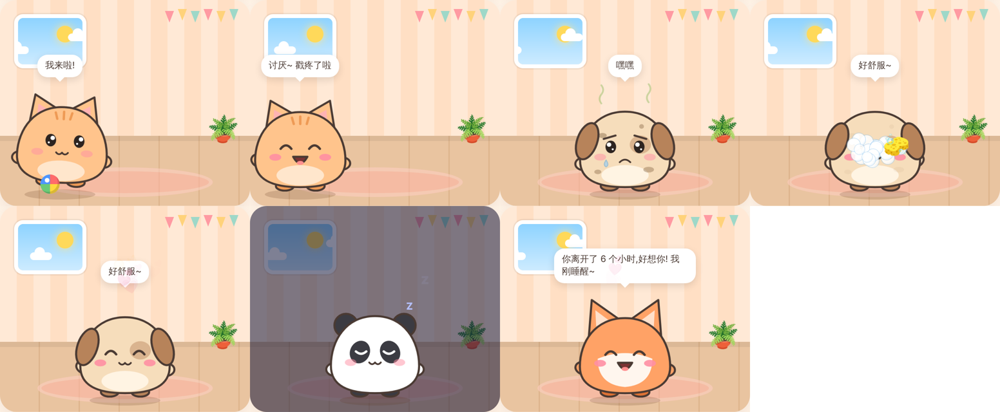

# ☁️ 云养宠物

🎮 **在线试玩:https://yiyayoh.github.io/cloud-pet/**(纯前端版,宠物存在你的浏览器里)

**新:🐶 3D 写实小狗** → https://yiyayoh.github.io/cloud-pet/dog.html
一只白色、毛茸茸的串串小狗,用 three.js 实时渲染:骨骼动画 + 多层毛发(shell fur)+ 物理光照和柔和阴影。
按住它来回摸会眯眼、歪头、猛摇尾巴,手摸过的地方毛会被压下去;点地板它会跑过来坐下;扔球它会追过去叼回来放在你脚边;会吃饭、洗澡(毛会被打湿塌下来,甩干后重新蓬起)、坐下、握手、趴下、自己挠痒痒、蜷成一团睡觉。拖动空白处可以转动视角。

在浏览器里养一只软乎乎的小团子。它住在云端:你不在的时候,它也会饿、会困、会变脏、会想你;回来时它会跑过来跟你打招呼。



## 怎么玩

| 互动 | 操作 |
| --- | --- |
| 🥚 破壳 | 领养后先得到一颗蛋,点 4 下帮它破壳 |
| 🤚 摸摸 | 按住宠物来回滑动,会冒爱心、眯眼、挥小手;摸多了还会掉金币 |
| 👉 戳戳 | 点一下它会吓一跳然后笑;连戳 5 下会生气转过身去 |
| 🍙 喂食 | 把食物**拖到它嘴边**(靠近时它会张嘴),或者点一下直接喂 |
| 🛁 洗澡 | 拿海绵在它身上搓,搓出泡泡,洗干净后闪闪发光 |
| ⚽ 扔球 | 点地板把球扔过去,它会追过去顶球 |
| 🍪 接零食 | 小游戏:左右移动接零食、躲西兰花,得分换金币 |
| 🌙 睡觉 | 关灯打呼噜,精力慢慢恢复,睡饱自动醒 |
| 🛍️ 商店 | 用金币买零食和装扮(蝴蝶结、王冠、眼镜、围巾……) |

其他小细节:眼睛会跟着鼠标或手指转、会随机眨眼、会自己在房间里溜达、需求低了会主动喊你;饿/脏太久会哭鼻子、冒臭气;窗外按真实时间显示白天或夜晚。



### 成长

幼崽 → 少年(120 成长值)→ 成年(400 成长值)。照顾它就能涨成长值,升级时会撒花、转圈、变大。

## 运行

需要 Node.js 18+,没有任何第三方依赖:

```bash
npm start          # http://localhost:3000
npm test           # 运行测试
```

用 `npm start` 启动时可以注册账号,宠物会同步到服务器,换设备也能看到。直接双击 `public/index.html` 也能玩,但只存在本机浏览器里。

环境变量:`PORT`(端口,默认 3000)、`DATA_FILE`(存档文件,默认 `data/db.json`)。

## 项目结构

```
public/
  index.html
  css/style.css      样式、表情切换、所有动画
  js/game.js         游戏规则(属性衰减、成长、金币、商店),不依赖 DOM,有单元测试
  js/pet-svg.js      用 SVG 绘制 8 种宠物、表情、装扮和蛋
  js/app.js          界面与互动
  js/minigame.js     接零食小游戏
  js/sound.js        WebAudio 合成音效
  js/storage.js      本地存档 + 云端同步
  dog.html           3D 小狗页面
  js/dog3d/          model.js 骨骼与毛发 · animator.js 姿势与程序动画 · main.js 互动与行为 · scene.js 场景灯光 · sfx.js 叫声
  vendor/three/      three.js r170(MIT 协议)
server/server.js     静态文件 + 账号 + 存档接口(纯 Node)
test/                node:test 测试
```

## 交接

继续开发前请先读 [docs/HANDOFF.md](docs/HANDOFF.md):项目背景、用户需求、架构、调试方法、已知问题和下一步建议都在里面。

## 后续计划

- [ ] 部署上线(需要一台能跑 Node 的服务器,或改用托管数据库)
- [ ] 好友互访、宠物广场
- [ ] 更多小游戏和装扮
- [ ] 服务端校验金币等数值(目前信任客户端,玩家可以改本地存档作弊)
- [ ] 安装为手机 App(PWA)和提醒推送

## 参考项目

- [GitHub topic: tamagotchi](https://github.com/topics/tamagotchi)
- [usik/tamagotchi](https://github.com/usik/tamagotchi):还原原版拓麻歌子的养成机制
- [kjdowns/pokepet](https://github.com/kjdowns/pokepet):Rails 宠物养成网页
